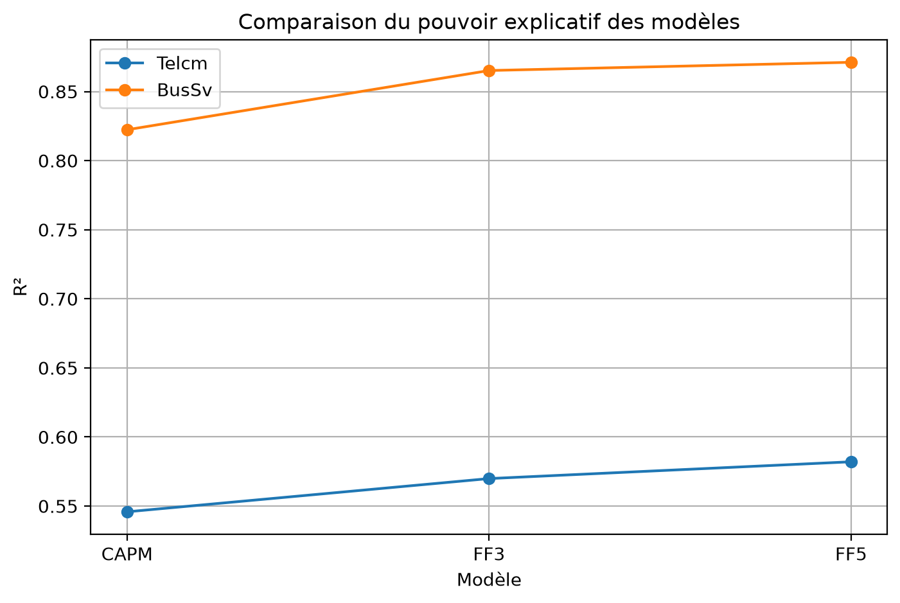
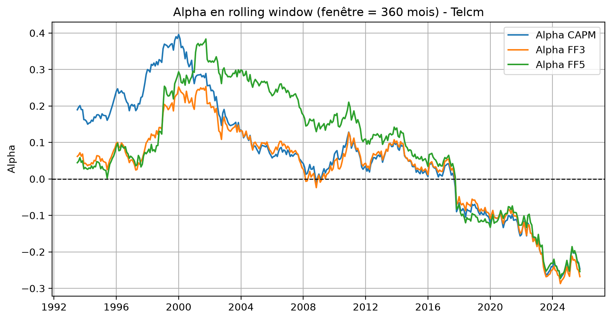
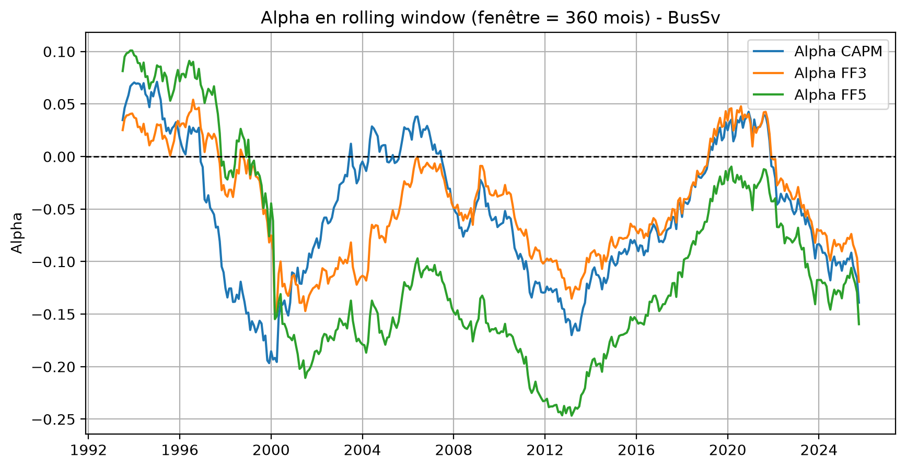

# Évaluation des actifs financiers — CAPM et modèles Fama-French

Projet réalisé dans le cadre du cours d'Évaluation des actifs financiers en Master 1 Économétrie Appliquée à l'IAE Nantes, en 2025-2026 avec Julien DUC.

## Objectif

Comparer le pouvoir explicatif du CAPM et des modèles Fama-French à trois et cinq facteurs sur les rendements excédentaires de deux portefeuilles sectoriels : **Telcm** (communication / télécommunications) et **BusSv** (services aux entreprises).

L'analyse étudie également l'évolution des expositions aux facteurs dans le temps et la significativité des alphas, afin de rechercher une éventuelle surperformance ajustée du risque.

## Données

L'échantillon commun comprend **748 observations mensuelles, de juillet 1963 à octobre 2025**.

- `Portefeuilles_Industries_49.csv` : rendements mensuels de 49 portefeuilles sectoriels ; seuls Telcm et BusSv sont analysés.
- `FamaFrench_5F.csv` : facteurs de marché, taille (SMB), valeur (HML), rentabilité (RMW), investissement (CMA) et taux sans risque (RF).
- `Industries.txt` : nomenclature des secteurs.

Les rendements sont exprimés en pourcentage mensuel. Les rendements excédentaires sont construits par différence entre le rendement sectoriel et le taux sans risque : **Ri − Rf**.

Les données proviennent de la [Kenneth R. French Data Library](https://mba.tuck.dartmouth.edu/pages/faculty/ken.french/data_library.html). Les copies utilisées sont conservées dans `data/raw/` afin de reproduire l'échantillon du notebook. La pondération des portefeuilles n'est pas précisée dans le CSV fourni.

## Méthodologie

L'analyse a été réalisée sous **Python** et comprend :

1. Préparation des données et alignement des dates.
2. Construction des rendements excédentaires et statistiques descriptives.
3. Estimation par moindres carrés ordinaires du CAPM et des spécifications à trois et cinq facteurs.
4. Comparaison des R² et tests individuels de significativité des alphas.
5. Estimation des coefficients en fenêtre glissante de **360 mois (30 ans)**.
6. Analyses complémentaires : fenêtre de 120 mois pour le CAPM, test de Chow et erreurs standards robustes HAC.

Dans ce notebook, la spécification à trois facteurs utilise les colonnes `Mkt-RF`, `SMB` et `HML` du fichier à cinq facteurs fourni. Elle ne correspond donc pas exactement à une estimation utilisant le fichier FF3 original : la construction de SMB diffère entre les deux jeux de facteurs. [Documentation des cinq facteurs](https://mba.tuck.dartmouth.edu/pages/faculty/ken.french/Data_Library/f-f_5_factors_2x3.html).

## Principaux résultats

### Comparaison du pouvoir explicatif

| Secteur | Modèle | R² | Alpha mensuel (%) | p-value de l'alpha |
|---|---|---:|---:|---:|
| Telcm | CAPM | 0,546 | −0,0195 | 0,868 |
| Telcm | Trois facteurs | 0,570 | −0,0749 | 0,514 |
| Telcm | Cinq facteurs | 0,582 | −0,0348 | 0,764 |
| BusSv | CAPM | 0,822 | −0,0715 | 0,419 |
| BusSv | Trois facteurs | 0,865 | −0,0630 | 0,418 |
| BusSv | Cinq facteurs | 0,871 | −0,1126 | 0,148 |

**Le pouvoir explicatif augmente du CAPM vers les modèles multifactoriels.** Sur l'échantillon étudié, le modèle à cinq facteurs présente le R² le plus élevé pour les deux secteurs. Les modèles expliquent davantage les variations de rendements de BusSv que celles de Telcm.

**Les alphas sont non significatifs au seuil de 5 %**, quelle que soit l'industrie ou la spécification, dans les estimations statiques présentées. Ces résultats ne mettent pas en évidence de surperformance ajustée du risque statistiquement significative sur l'ensemble de la période.



### Analyse dynamique et tests complémentaires

Les fenêtres glissantes permettent de visualiser les variations progressives des bêtas et des alphas dans le temps.





Les vérifications complémentaires portent sur des cas précis :

- **Fenêtres de 120 et 360 mois** : le CAPM est estimé pour les deux secteurs ; le graphique de comparaison affiché concerne Telcm.
- **Test de Chow sur Telcm, pour le CAPM**, avec une rupture fixée à septembre 2008 : F ≈ 0,986 et p-value ≈ 0,374. Le test ne rejette pas la stabilité des paramètres à cette date au seuil de 5 %.
- **Erreurs standards HAC sur BusSv, pour le CAPM**, avec six retards : l'alpha demeure non significatif (p-value ≈ 0,471).

### Conclusion et portée des résultats

Les résultats sont cohérents avec la théorie des modèles d'évaluation des actifs et ne mettent pas en évidence de surperformance ajustée du risque dans les tests statiques réalisés.

Les R² présentés mesurent l'ajustement **sur l'échantillon d'estimation** ; ils ne constituent pas une évaluation prédictive hors échantillon. Les tests complémentaires ne couvrent pas toutes les combinaisons de secteurs et de modèles. Les graphiques d'alphas glissants ne comportent pas d'intervalles de confiance : leur inspection visuelle ne permet pas, à elle seule, de conclure à l'absence de surperformance à chaque sous-période.

## Technologies utilisées

- Python
- NumPy et pandas : préparation et traitement des données
- statsmodels : régressions MCO et erreurs standards HAC
- SciPy : loi de Fisher pour le test de Chow
- Matplotlib : visualisations et exports
- Jupyter : notebook d'analyse

## Structure du dépôt

```text
evaluation-actifs-financiers/
├── README.md
├── .gitignore
├── requirements.txt
├── code/
│   └── analyse_actifs_financiers.ipynb
├── data/
│   └── raw/
│       ├── FamaFrench_5F.csv
│       ├── Portefeuilles_Industries_49.csv
│       └── Industries.txt
├── rapport/
│   └── rapport.pdf
└── figures/
    ├── comparaison_r2.png
    ├── alpha_rolling_telcm.png
    ├── alpha_rolling_bussv.png
    └── robustesse_beta_telcm.png
```

## Reproduire l'analyse

Avec Python 3, depuis la racine du dépôt :

```bash
python -m pip install -r requirements.txt
python -m jupyterlab
```

Ouvrir `code/analyse_actifs_financiers.ipynb`, puis exécuter toutes les cellules dans l'ordre. Le notebook peut être lancé avec un dossier de travail situé à la racine du dépôt ou dans `code/`.

Les sorties enregistrées dans le notebook permettent également de consulter les tableaux et graphiques directement sur GitHub. Les quatre images de `figures/` ont été extraites de ces sorties.

La cellule d'export génère des tableaux CSV/PDF et des figures PDF dans `annexes_tableaux/` et `annexes_figures/`, à la racine du projet. Ces exports sont ignorés par Git ; ils ne sont pas inclus dans le dépôt initial.

## Rapport

[Consulter le rapport complet (PDF)](rapport/rapport.pdf)

Le rapport universitaire original présente la démarche, les interprétations, la discussion des modèles et les annexes. Ses tableaux reprennent les résultats du notebook. Il est conservé dans sa version originale.

## Auteur

**Amélie Pires**

Master 1 Économétrie Appliquée — Évaluation des actifs financiers — IAE Nantes, 2025-2026.

## Contact

[Mail](mailto:amelie.pires@hotmail.com) · [LinkedIn](https://www.linkedin.com/in/amelie-pires) · [GitHub](https://github.com/aps-18)
